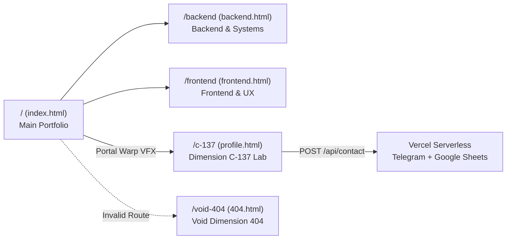

# 🌌 Wiki — Nisfal Filsa Portfolio (`nisfal/me`)

Selamat datang di dokumentasi resmi repositori **[nisfal/me](https://github.com/nisfal/me)** — portofolio interaktif *Fullstack & Systems Engineer* milik **Nisfal Filsa** yang memadukan portofolio profesional berkinerja tinggi dengan dunia eksperimental bertema **Rick and Morty (Dimension C-137)**.

> **Live Production:** [https://nisfal.vercel.app](https://nisfal.vercel.app)  
> **Dimension C-137 (Casual & Interactive Lab):** [https://nisfal.vercel.app/c-137](https://nisfal.vercel.app/c-137)

---

## ✨ Highlight Utama Proyek

| Area | Deskripsi Singkat | Halaman Wiki |
| :--- | :--- | :--- |
| **Arsitektur & Routing** | Multi-page static HTML/CSS/JS + Vercel Serverless API, Clean URLs (`/c-137`, `/void-404`), dan hardware-accelerated rendering 60 FPS. | [[Architecture-and-Directory-Structure]] |
| **Dimension C-137 Lab** | Pengalaman interaktif bertema Rick & Morty: 3D Flippable Citadel ID/Wanted Card, 4 Tema Dimensi, Interdimensional Cable TV, Mr. Meeseeks Box, Microverse Testimonials, Robot Companion, Space Shooter Minigame, & Native Web Audio FX. | [[Dimension-C137-Interactive-Lab]] |
| **Brainwave Masking (`mask.js`)** | Engine sensor data sensitif (*PII & Secret Redaction*) untuk 18+ jenis entitas (JWT, DB URI, API Key, NIK, NPWP, CC, Private Key, dll.) lengkap dengan Dual Oscilloscope & dukungan CLI/Browser. | [[Brainwave-Masking-Engine]] |
| **Quantum JSON Synthesizer (`json-lab.js`)** | Dual-Chamber JSON Beautifier/Minifier (*De-Cronenberger*) dengan nomor baris & auto-unescape, plus Semantic JSON Comparator (*Timeline Divergence Scanner*) terintegrasi `mask.js`. | [[Quantum-JSON-Synthesizer]] |
| **Bilingual i18n & SEO** | Sistem bahasa dinamis **ID / EN** tanpa reload halaman, sinkronisasi query parameter `?lang=`, Schema.org JSON-LD, dan generator OG Image otomatis. | [[Internationalization-and-SEO]] |
| **Subspace Terminal API & Deploy** | Vercel Serverless Function `/api/contact` berlapis 4 proteksi keamanan (Honeypot, Rate Limiter, Timing Proof, Anti-Link Spam) dengan relay ke **Telegram Bot** dan **Google Sheets**. | [[Subspace-Terminal-API-and-Deployment]] |

---

## 🗺️ Peta Halaman Website



---

## 🚀 Quick Start (Lokal)

```bash
# 1. Clone repositori
git clone https://github.com/nisfal/me.git
cd me

# 2. Salin konfigurasi environment (opsional, untuk tes /api/contact)
cp .env.example .env

# 3. Jalankan static server lokal
npx serve .
# atau gunakan Python 3
python -m http.server 3000
```

Buka `http://localhost:3000` untuk halaman utama atau `http://localhost:3000/c-137` (jika memakai `npx serve .` yang membaca `serve.json`) / `http://localhost:3000/profile.html` untuk masuk ke **Dimension C-137**.

---

## 📚 Daftar Lengkap Halaman Wiki

1. [[Architecture-and-Directory-Structure]] — Struktur kode, CSS design system, dan arsitektur routing.
2. [[Dimension-C137-Interactive-Lab]] — Seluruh fitur interaktif, animasi, game, dan Web Audio FX di `profile.html`.
3. [[Brainwave-Masking-Engine]] — Dokumentasi teknis `js/mask.js` (CLI, Module, Browser, daftar 18+ entitas).
4. [[Quantum-JSON-Synthesizer]] — Dokumentasi teknis `js/json-lab.js` (Beautify, Minify, Semantic Diff, Integrasi).
5. [[Internationalization-and-SEO]] — Panduan `js/i18n.js`, penambahan key terjemahan, dan render OG Image.
6. [[Subspace-Terminal-API-and-Deployment]] — Dokumentasi API `/api/contact`, environment variables, deploy Vercel, & cara publish GitHub Wiki.
